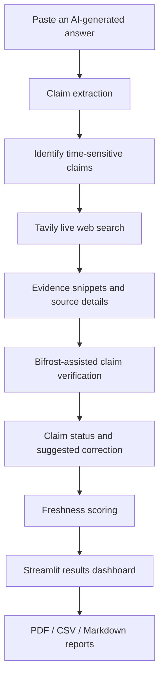

deStale — AI Stale-Answer Detector

  

  <strong>Check whether factual claims in an AI-generated answer are still current.</strong>

  
  
  
  
  

deStale is a verification layer for AI-generated answers. It extracts factual claims, searches for current web evidence, evaluates each claim, and calculates an overall freshness score. It is designed to help people spot statements that may be outdated, contradicted, uncertain, or not sufficiently supported by the evidence found.
Built for Geek Room Global AI Hackathon 2026 — Problem Statement 06: Build a Stale-Answer Detector for AI Applications.

The problem
AI-generated answers can contain facts that were once correct but have since changed. Examples include product prices, software versions, API behaviour, regulations, public statistics, and company leadership. A fluent answer does not necessarily mean that every claim is current.
What deStale does
1. Claim identification — breaks an answer into individual factual claims and identifies claims that may be time-sensitive.
2. Live evidence search — uses Tavily to search the web for information related to each claim.
3. Claim verification — uses a model accessed through the Bifrost gateway to assess claims against the retrieved evidence.
4. Freshness scoring — calculates a transparent heuristic score for each claim and the complete answer.
5. Review and export — presents findings in a Streamlit dashboard and supports downloadable reports.
Verification outcomes
Outcome	Meaning
Verified / Supported	The available evidence supports the claim.
Outdated	The claim appears to have been superseded by newer information.
Contradicted	The retrieved evidence conflicts with the claim.
Uncertain	The evidence is conflicting or does not support a clear decision.
Insufficient Evidence	The search did not return enough useful evidence to assess the claim.

A result is only as reliable as the sources retrieved and the evidence assessment. Users should open the cited sources and independently review important or high-impact claims.
How the system works

Technology stack
Technology	Role in this project
Python	Application and verification logic
Streamlit	Interactive web dashboard
Tavily Search API	Live web search and evidence retrieval
Bifrost by Maxim AI	Gateway used to send model requests for extraction and verification
Pydantic	Structured data models and validation
Requests	HTTP communication with APIs and the gateway
ReportLab	PDF report generation
Pytest	Automated tests

Freshness score
The overall score is a heuristic index from 0 to 100. It is not a calibrated probability that an answer is correct.

The aggregate score uses a weighted average:
\[
\text{Overall Score} = \frac{\sum (\text{Claim Score} \times \text{Claim Weight})}{\sum \text{Claim Weight}}
\]
Time-sensitive claims receive a weight of 1.5; other claims receive a weight of 1.0. Individual claim scores are influenced by the verification outcome and evidence-related adjustments implemented in freshness_scorer.py.

The dashboard uses these overall score bands:
Score	Label
80–100	Fresh & Accurate
50–79.9	Moderate Stale Risk
0–49.9	High Stale / Outdated Risk

Treat the score as a review aid, not a substitute for checking sources—especially for legal, medical, financial, or safety-critical information.
Project structure
deStale/
├── .github/workflows/ci.yml  # Automated test workflow
├── assets/logo.svg           # Project logo
├── docs/
│   ├── ARCHITECTURE.md       # Architecture and security notes
│   ├── DEMO_SCRIPT.md        # Hackathon demo walkthrough
│   ├── PRESENTATION.md       # Presentation outline
│   └── VIVA_QUESTIONS.md     # Technical viva preparation
├── tests/                    # Unit and mocked integration tests
├── app.py                    # Streamlit application
├── bifrost_client.py         # Bifrost gateway client
├── claim_extractor.py        # Factual claim extraction
├── config.py                 # Environment-based configuration
├── demo_data.py              # Curated demo scenarios
├── fact_verifier.py          # Evidence-based claim assessment
├── freshness_scorer.py       # Claim and aggregate scoring
├── models.py                 # Pydantic data models
├── report_generator.py       # PDF, CSV and Markdown exports
├── tavily_search.py          # Tavily search client
├── utils.py                  # Shared helpers and input handling
├── requirements.txt          # Python dependencies
├── .env.example              # Environment variable template
└── README.md
Run locally
1. Requirements
- Python 3.11 or newer
- Git
- A Tavily API key for live web search
- A running Bifrost gateway with a configured model provider for live AI extraction and verification
2. Clone the repository
git clone https://github.com/Sidharth1025/deStale.git
cd deStale
3. Create and activate a virtual environment
Windows PowerShell:
python -m venv .venv
.venv\Scripts\Activate.ps1
If PowerShell prevents script activation, use Command Prompt instead:
.venv\Scripts\activate.bat
macOS / Linux:
python3 -m venv .venv
source .venv/bin/activate
4. Install dependencies
python -m pip install --upgrade pip
pip install -r requirements.txt
5. Configure environment variables
Copy the example file:
# Windows PowerShell
Copy-Item .env.example .env
# macOS / Linux
cp .env.example .env
Edit .env and provide your own values:
BIFROST_BASE_URL=http://localhost:8080/v1
BIFROST_API_KEY=your_bifrost_or_provider_key
BIFROST_MODEL=gpt-4o-mini
BIFROST_TIMEOUT=45
BIFROST_MAX_RETRIES=3

TAVILY_API_KEY=tvly-your_tavily_api_key
TAVILY_SEARCH_DEPTH=advanced
TAVILY_MAX_RESULTS=5
TAVILY_TIMEOUT=20
TAVILY_MAX_RETRIES=3

DEMO_MODE=false
Get a Tavily key from Tavily. Configure and start your Bifrost gateway by following the Bifrost documentation. The default gateway URL in this project is http://localhost:8080/v1; change it if your gateway uses another address.

Keep .env private. It is excluded by .gitignore. Never put real API keys in source files, screenshots, issues, or commits. If a key is exposed, revoke it with its provider and create a new one.
6. Start the dashboard
streamlit run app.py
Open http://localhost:8501 in your browser.
Demo and live mode
The repository includes curated demo scenarios for exploring the interface. Demo/fallback output is illustrative and is not proof of a live web check. To perform live verification, make sure the Bifrost gateway and model provider are reachable and that valid Bifrost and Tavily credentials are configured. Check the displayed mode and evidence sources before describing a result as live.
Run the tests
The automated tests use mocked responses; they are intended to test application logic without consuming live API credits.
pytest -v tests/
Reports
The application includes report export functionality for:
- PDF
- CSV
- Markdown
Hackathon integrations
The hackathon statement requires both Tavily and Bifrost. This repository uses them as follows:
Required integration	Implementation	Contribution
Tavily	tavily_search.py	Retrieves current web search evidence for factual claims.
Bifrost by Maxim AI	bifrost_client.py	Routes model requests used in claim extraction and evidence-based verification.

Documentation
- [System architecture](docs/ARCHITECTURE.md)
- [Demo script](docs/DEMO_SCRIPT.md)
- [Presentation outline](docs/PRESENTATION.md)
- [Viva questions and answers](docs/VIVA_QUESTIONS.md)
- [Complete project documentation (PDF)](deStale_Complete_Project_Documentation.pdf)
- [GitHub upload guide](GITHUB_UPLOAD_GUIDE.md)
Contributing
Contributions are welcome. Please read [CONTRIBUTING.md](CONTRIBUTING.md) before opening a pull request. Follow the [Code of Conduct](CODE_OF_CONDUCT.md).
Security
Please do not report security vulnerabilities in public issues. Follow the instructions in [SECURITY.md](SECURITY.md).
License
This project is licensed under the MIT License.
Repository: github.com/Sidharth1025/deStale
